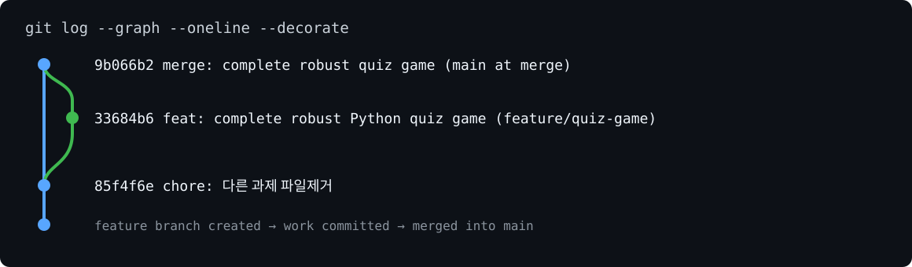
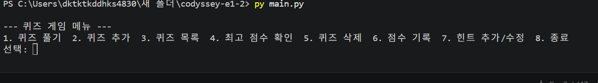
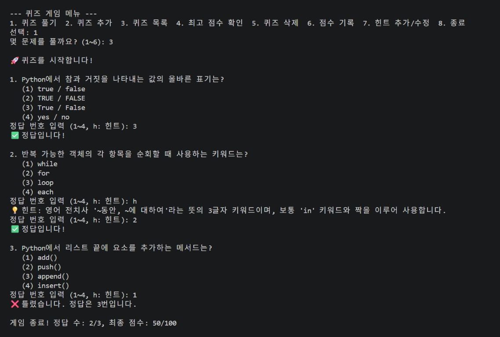
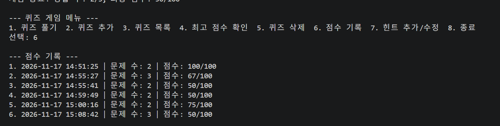
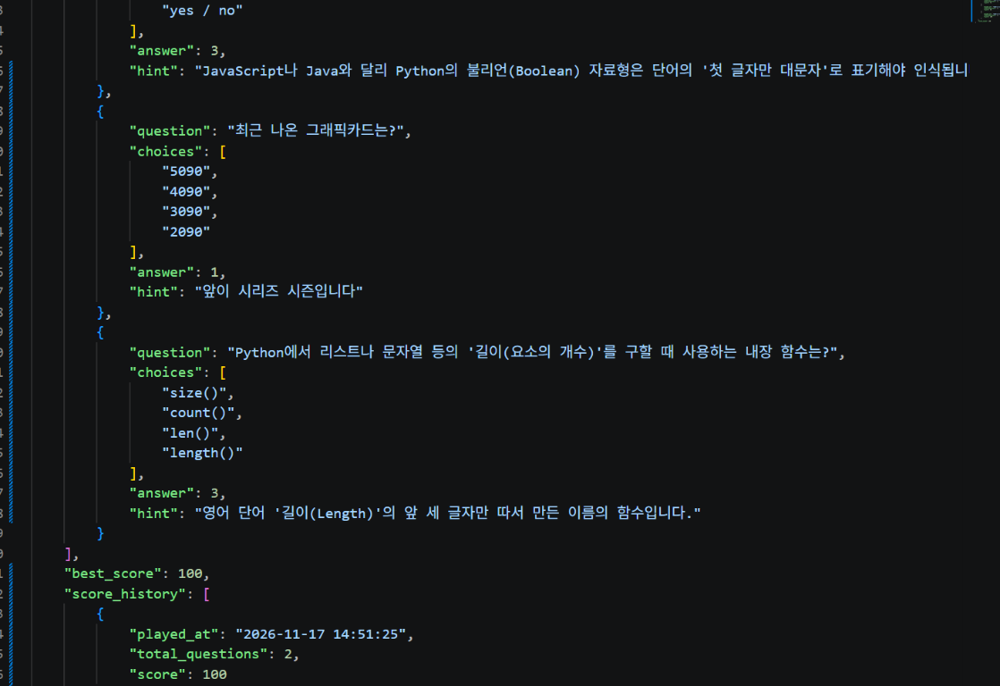
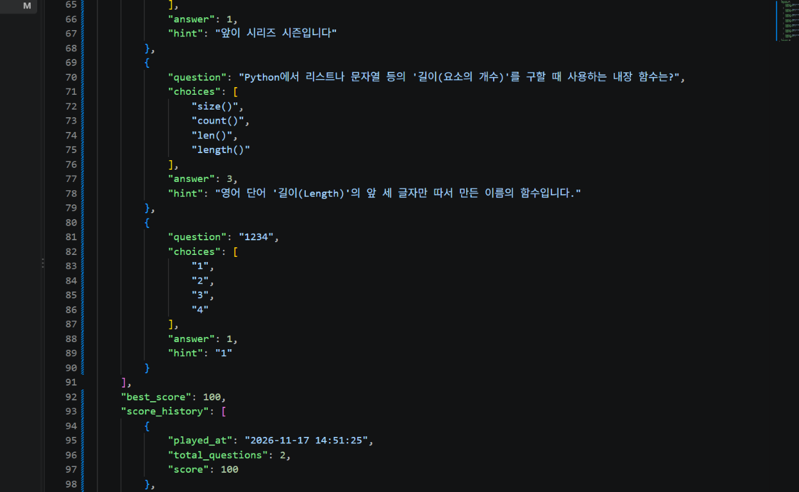

# Python 퀴즈 게임

## 프로젝트 개요

Python 기초 개념을 익히는 콘솔 기반 퀴즈 게임입니다. 문제를 풀고, 힌트를 활용하며, 점수와 기록을 JSON 파일로 저장해 재사용할 수 있습니다.

## 코드 구조

### `Quiz` 클래스

퀴즈 한 문제를 표현합니다. 문제 내용, 네 개의 선택지, 정답 번호, 힌트를 보관하며 문제 출력(`display`), 힌트 표시(`show_hint`), 정답 확인(`is_correct`), JSON 저장용 변환(`to_dict`)을 담당합니다.

### `QuizGame` 클래스

게임 전체 흐름과 데이터를 관리합니다. 메뉴와 입력 검증, 퀴즈 출제·채점, 퀴즈 추가·삭제·힌트 관리, 최고 점수와 게임 기록을 다룹니다. 입력(`get_input`), 게임 진행(`play_game`), 데이터 불러오기(`load_data`)와 저장(`save_data`)은 각각 별도 메서드로 분리되어 있습니다.

### `GracefulExit` 클래스

Ctrl+C 또는 입력 스트림 종료 상황에서 저장을 시도한 뒤 안전하게 게임을 종료할 때 사용합니다.

게임 데이터는 `main.py`와 같은 프로젝트 루트의 `state.json`에 UTF-8 JSON으로 저장하고 불러옵니다.

## 요구사항 변경 시 수정 위치

| 변경 내용 | 관련 위치 |
| --- | --- |
| 퀴즈 항목·선택지·힌트 필드 변경 | `Quiz.__init__`, `Quiz.to_dict`, `QuizGame.default_quizzes`, `QuizGame._parse_state` |
| 점수 계산·힌트 사용 점수 반영 | `QuizGame.play_game`의 정답 처리와 `final_score` 계산 |
| 메뉴·입력 검증·퀴즈 추가/삭제/힌트 관리 | `QuizGame.run`, `get_input`, `add_quiz`, `delete_quiz`, `add_hint` |
| 데이터 스키마·불러오기·저장·백업 변경 | `QuizGame._parse_state`, `load_data`, `save_data` 및 아래 `state.json` 설명 |
| 점수 기록 표시 변경 | `QuizGame.show_score_history` |

## GitHub 저장소와 브랜치 이력

- 원격 저장소: [strsrt/codyssey-e1-2](https://github.com/strsrt/codyssey-e1-2)
- 커밋 이력: [GitHub commits](https://github.com/strsrt/codyssey-e1-2/commits/main)

퀴즈 게임 기능은 `feature/quiz-game` 브랜치에서 작업한 뒤 `main`에 병합했습니다. 아래는 해당 브랜치 생성·작업·병합 과정을 보여주는 Git 로그 그래프입니다.



### Clone/Pull 실습 기록

- 별도 폴더에 저장소를 복제했습니다: `git clone https://github.com/strsrt/codyssey-e1-2.git <별도-작업폴더>`
- 복제본의 README를 수정해 커밋하고 푸시했습니다: [`df49c00`](https://github.com/strsrt/codyssey-e1-2/commit/df49c00) (`docs: add clone-practice note`)
- 원래 작업 폴더에서 `git pull origin main --ff-only`를 실행했습니다. `9b066b2`에서 `df49c00`으로 Fast-forward된 것을 확인했습니다.

## 퀴즈 주제와 선정 이유

주제는 Python 기본 문법입니다. 리스트, 딕셔너리, 반복문, 함수, 논리값은 실제 프로그래밍을 시작할 때 가장 자주 접하는 개념이어서 선택했습니다.

## 실행 방법

Python 3가 설치된 환경에서 프로젝트 폴더로 이동해 다음 명령으로 실행합니다.

```text
python main.py
```

다음처럼 바로 실행해도 같은 프로그램이 동작합니다.

```text
python quiz_game.py
```

## 기능 목록

- 랜덤으로 문제 순서를 섞어 출제
- 문제 수를 직접 선택해 퀴즈 풀기
- 퀴즈 개수와 무관하게 100점 만점으로 점수 환산
- 힌트를 사용하고 정답을 맞히면 해당 문제 배점의 절반 반영
- 새 퀴즈 추가(문제, 선택지 4개, 정답 번호, 필수 힌트)
- 기존 퀴즈에 힌트 추가 또는 수정
- 등록된 퀴즈 삭제
- 퀴즈 목록 확인
- 최고 점수 확인 및 갱신
- 모든 게임 기록 확인
- 빈 입력, 숫자 변환 실패, 범위 밖 입력 재입력 처리
- Ctrl+C, EOF 등 안전 종료 처리
- 상태 파일이 없거나 손상되면 기본 퀴즈 복구

힌트를 사용하지 않고 모든 문제를 맞히면 100점입니다. 점수는 가장 가까운 정수로 반올림합니다.

## 대량 퀴즈 데이터 처리 (1,000개 이상)

현재 구현은 퀴즈 전체를 `state.json`에서 메모리로 불러와 처리합니다. 1,000개 정도는 일반적인 로컬 환경에서 충분히 다룰 수 있을 것으로 예상되지만, 별도의 성능·메모리 벤치마크는 수행하지 않았습니다. 데이터가 커지면 다음 지점이 병목이 될 수 있습니다.

- **시작 및 메모리:** `json.load`가 파일 전체를 읽고 퀴즈 객체로 변환하므로 시작 시간과 메모리 사용량이 퀴즈 수에 비례해 증가합니다.
- **출제:** 현재는 퀴즈 목록을 복사한 뒤 전체를 섞으므로 전체 문제 수에 비례하는 시간과 추가 메모리가 필요합니다.
- **목록 및 검색:** 목록 표시와 삭제·힌트 대상 선택은 전체 퀴즈를 순회합니다. 키워드 검색 기능은 아직 없으며, 추가하더라도 단순 순회 방식은 퀴즈 수에 비례합니다.
- **저장 및 기록:** 퀴즈나 점수 기록을 저장할 때 JSON 전체를 다시 씁니다. 게임 기록이 계속 쌓이면 파일 크기와 저장 시간이 커집니다.

개선 방향은 필요한 문제만 뽑을 때 전체 목록을 복사·셔플하는 대신 `random.sample`을 검토하고, 목록은 페이지 단위로 출력하는 것입니다. 키워드 검색이 필요하면 검색 인덱스를 두고, 데이터가 더 커지거나 쓰기가 잦아지면 JSON 대신 SQLite의 인덱스·부분 조회·트랜잭션을 검토합니다. 실제 최적화 전에는 1,000개와 더 큰 데이터 세트에서 시작 시간, 퀴즈 출제 시간, 메모리 사용량을 측정합니다.

## 파일 구조

```text
.
├── main.py       # Quiz, QuizGame 클래스와 게임 로직
├── quiz_game.py  # main.py를 호출하는 실행 진입점
├── state.json    # 퀴즈, 최고 점수, 점수 기록 저장 파일
├── state.json.bak  # 저장 직전 state.json 백업(자동 생성)
├── screenshots/  # README 실행 화면 및 Git 이력 이미지
├── README.md
├── .gitignore
```

## 실행 화면 예시

### 게임 메뉴



### 퀴즈 풀기와 힌트 사용



### 점수 기록 확인



## 퀴즈 추가 전후의 `state.json`

퀴즈를 추가하면 새 퀴즈 객체가 `quizzes` 배열의 끝에 저장됩니다. 기존 문제와 최고 점수, 점수 기록은 유지됩니다. 아래 예시에서는 `1234` 문제가 추가된 모습을 확인할 수 있습니다.

### 추가 전



### 추가 후



## 데이터 파일 설명

`state.json`은 `main.py`와 같은 프로젝트 루트에 위치하며 UTF-8 인코딩으로 저장됩니다. 파일이 없으면 기본 퀴즈로 생성하고, 손상된 경우 안내 후 기본 데이터로 초기화합니다. 파일 구조는 다음과 같습니다.

기존 `state.json`을 덮어쓸 때는 먼저 같은 폴더의 `state.json.bak`으로 복사합니다. 백업 생성에 실패하면 원본 파일을 덮어쓰지 않습니다. 백업은 직전 저장 상태 하나만 보관하므로 다음 저장 시 갱신됩니다.

### 백업에서 복원하기

1. 게임을 종료합니다.
2. 프로젝트 루트에서 현재 파일을 보존하고 백업으로 복원합니다.

```powershell
if (Test-Path .\state.json) {
    Copy-Item .\state.json .\state.json.before-restore
}
Copy-Item .\state.json.bak .\state.json -Force
```

`state.json.bak`이 없으면 저장 전 백업이 생성되지 않은 첫 실행 상태일 수 있습니다. 복원 후 게임을 실행해 퀴즈와 점수를 확인하세요.

- `quizzes`: 문제 목록
  - `question`: 문제 내용
  - `choices`: 선택지 4개
  - `answer`: 정답 번호(1~4)
  - `hint`: 힌트 문자열
- `best_score`: 100점 만점 기준 최고 점수
- `score_history`: 각 게임의 기록 목록
  - `played_at`: 게임 종료 시각
  - `total_questions`: 푼 문제 수
  - `score`: 100점 만점으로 환산한 최종 점수
- `score_scale`: 점수 기준 버전(현재 `100`); 이전 데이터는 최초 로드 시 백분율 점수로 변환

```json
{
  "quizzes": [
    {
      "question": "질문",
      "choices": ["선택지 1", "선택지 2", "선택지 3", "선택지 4"],
      "answer": 1,
      "hint": "간단한 힌트"
    }
  ],
  "best_score": 60,
  "score_history": [
    {
      "played_at": "2026-11-17 14:00:00",
      "total_questions": 5,
      "score": 60
    }
  ],
  "score_scale": 100
}
```
